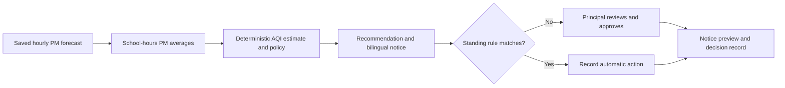

# Saans · School Air Action Desk

Saans is a prototype for a school principal deciding whether to hold outdoor assembly and PE on a polluted morning. It turns a forecast into a clear action, prepares a bilingual family notice, and keeps approval in the principal's hands. An optional standing rule can record the action automatically on later bad-day replays.

## Run locally

Requires Node.js 20 or later. No package installation or API keys are needed for the replay demo.

```sh
npm start
```

Open [http://localhost:5000](http://localhost:5000). The demo uses saved, deterministic Delhi scenarios so the full flow works offline. Use **Run replay** to try a clean day or a very poor day. Create a standing rule and run the very poor replay again to see the automatic branch. Approval and dispatch are represented by a recorded state change and on-screen preview; Saans does not send SMS or email.

To change the demo school, copy `.env.example` to `.env` and set `SCHOOL_NAME`, `SCHOOL_LAT`, `SCHOOL_LNG`, `SCHOOL_START`, and `SCHOOL_END`. Environment files are not committed.

## How the loop works



## Where AWS fits

| Service | Intended role | MVP status |
|---|---|---|
| Amazon Bedrock | Optional wording assistance for the bilingual notice | Not wired in this local MVP; fixed templates are used |
| Amazon EventBridge | Trigger the daily job through `POST /api/cron/daily` | Endpoint exists; schedule and secret must be configured |
| AWS hosting | Host the app for a public demo | Not deployed |
| MongoDB Atlas | Store principals, schools, rules, and decisions | Replaced by a local JSON file in this MVP |

## API

- `GET /api/health`
- `GET /api/decisions/today`
- `GET /api/decisions`
- `POST /api/decisions/:id/approve`
- `GET|POST /api/rules`, `DELETE /api/rules/:id`
- `POST /api/replay/run` with `{ "mode": "bad" }` or `{ "mode": "clean" }`
- `POST /api/cron/daily` (checks `x-cron-secret` when `CRON_SECRET` is configured)

## Limitations

- Forecasts in this MVP are saved example data, not a live Open-Meteo feed or a school playground sensor.
- The CPCB breakpoint tables are implemented as planning estimates and need verification against the official table before any public health use. Saans averages PM readings over school hours; official AQI reporting uses 24-hour averages.
- Recommendations are a school operations aid, not a health advisory. Schools should follow local public-health and education guidance.
- Hindi and English messages use fixed templates. The model does not select the action.
- The JSON store is local and not suitable for multiple users or production hosting. There is no login or multi-school isolation in this MVP.
- Approval records a notice preview; no real communication is sent.

## AI and third-party code disclosure

AI coding tools: disclose the tools used to produce this repository before submitting to a hackathon. No third-party application code is bundled. The UI imports DM Sans and Manrope from Google Fonts when internet access is available; system sans-serif fonts are used otherwise.
