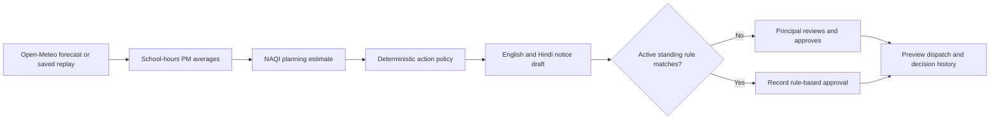

# Saans · School Air-Quality Action Desk

Saans helps a school principal make a clear outdoor-activity decision on a polluted morning. It calculates a school-hours planning estimate from hourly PM2.5 and PM10, recommends an action in deterministic code, drafts a bilingual parent notice, and records approval. An expiring standing rule can handle later matching days automatically.

## Run locally

Requires Node.js 20.19+ (or 22.12+), npm, and Docker (or a local MongoDB service).

```sh
docker compose up -d mongo
cp server/.env.example server/.env          # PowerShell: Copy-Item server/.env.example server/.env
npm install
npm --prefix server install
npm --prefix client install
npm run seed
npm run dev
```

Open the Vite URL printed in the terminal (normally `http://localhost:5173`). Demo login: `principal@saans.demo` / `schoolair`. The app starts with saved replay forecasts and fixed bilingual templates, so the core story works without external API calls or AWS credentials. Try a bad day, approve the preview, create a standing rule, and replay another bad day to see the automatic action.

Set `FORECAST_PROVIDER=live` to use the [Open-Meteo hourly Air Quality API](https://open-meteo.com/en/docs/air-quality-api) for the school's configured coordinates. The saved scenarios remain available from the replay selector. Set `LLM_PROVIDER=bedrock` to ask Amazon Nova 2 Lite for wording; deterministic policy still selects the action, and validation falls back to fixed templates if Bedrock fails or returns unsuitable text. The default model ID is the US inference profile `us.amazon.nova-2-lite-v1:0`. AWS credentials should come from the environment or an instance role, never from committed files.

## Product loop



## AWS architecture

| Service | Role | Configuration |
|---|---|---|
| Amazon Bedrock | Optional bilingual wording from fixed facts | `LLM_PROVIDER=bedrock`, `AWS_REGION`, `BEDROCK_MODEL_ID`; grant the runtime role access to the US inference profile |
| Amazon EventBridge | Trigger the daily school run | `POST /api/cron/daily` with `x-cron-secret` |
| AWS hosting (for example App Runner) | Host the Docker image | Use a managed instance role for Bedrock access |
| MongoDB Atlas | Persistent school, rule, and decision data | Set `MONGODB_URI` to the Atlas connection string |

For local development, `node-cron` calls the same daily job at `DAILY_CRON` (default 06:00 Asia/Kolkata). On a hosted deployment, set `ENABLE_LOCAL_CRON=false` if EventBridge owns it, to avoid duplicate runs.

## API

All routes except health, login, and the secret-protected cron endpoint require a JWT bearer token.

- `GET /api/health`
- `POST /api/auth/login`, `GET /api/auth/me`
- `GET /api/decisions/today`, `GET /api/decisions`
- `POST /api/decisions/:id/approve` (a second approval returns 409)
- `GET|POST /api/rules`, `DELETE /api/rules/:id`
- `POST /api/replay/run` with `{ "mode": "bad" }` or `{ "mode": "clean" }`
- `POST /api/cron/daily` with `x-cron-secret`

## Run tests and build

```sh
npm test
npm run build
```

The server uses Node's built-in test runner. The production container can be built from the repository root with `docker build -f server/Dockerfile -t saans .`; provide MongoDB and secrets at runtime.

## Data and safety limits

- Open-Meteo provides modelled air-quality forecasts, not a playground sensor. Saved replay fixtures are illustrative demo data.
- The CPCB breakpoint values need confirmation against the official table before public use. Saans computes from school-hours means; official AQI reporting uses 24-hour averages. This estimate is not a health advisory.
- The model only drafts wording. Code chooses the action and validates generated wording; a fixed template is the fallback.
- Approval records a preview and status change. No SMS or email is sent.
- The principal must approve proposed notices. A standing rule is an explicit exception the principal creates, scopes by category, and gives an expiry date.
- Use a strong `JWT_SECRET` and `CRON_SECRET`, HTTPS, and a protected MongoDB connection in any hosted environment. Demo credentials are for local use only.

## Disclosure

AI coding tool used: OpenAI Codex. Direct open-source dependencies and their licenses are listed in [THIRD_PARTY_NOTICES.md](./THIRD_PARTY_NOTICES.md). The UI loads DM Sans and Manrope from Google Fonts when online; system fonts are the fallback.
