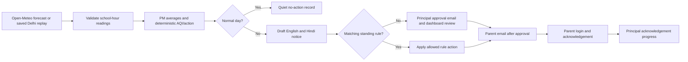

# Saans · School Air-Quality Action Desk

Saans helps a principal review modelled air-quality estimates for school hours, apply a deterministic outdoor-activity policy, and approve a bilingual notice for families. Good through Moderate days are recorded quietly with no parent notice. Poor days can limit outdoor time to a suitable window; Very Poor and Severe days propose cancelling outdoor activities. A matching, time-limited standing rule can take the configured action automatically.

## Run locally

Requires Node.js 20+, npm, and Docker (or a local MongoDB service).

```powershell
docker compose up -d mongo
Copy-Item server/.env.example server/.env
npm install
npm --prefix server install
npm --prefix client install
npm run seed
npm run dev
```

Open the Vite URL (normally `http://localhost:5173`). Demo principal login: `principal@saans.demo` / `schoolair`. To enable demo parent accounts, set `DEMO_PARENT_EMAILS` to real test addresses and `DEMO_PARENT_PASSWORD` in `server/.env`, then run `npm run seed`. Never use fake email addresses for a delivery demo.

New principals can use **Create a school account** on the login page, then enter their school location and hours. The timezone is fixed to `Asia/Kolkata` and the supported coordinate bounds are India. The dashboard includes school settings, a live location preview, parent invitations, a parent portal, acknowledgements, decision history, standing rules, and dated replay scenarios.

## Data and limitations

Live forecasts come from the [Open-Meteo Air Quality API](https://open-meteo.com/en/docs/air-quality-api), requested for the configured coordinates and timezone. Locality suggestions use the [Open-Meteo Geocoding API](https://open-meteo.com/en/docs/geocoding-api). The forecast is a regional model and cannot distinguish nearby streets; it is not a school sensor reading or a health advisory. Saans estimates school-hours averages from hourly PM2.5 and PM10 values and applies its deterministic AQI/action policy.

The repository includes three dated Delhi examples for the replay demo: Very Poor, PM2.5-driven (22 Nov 2025), Poor (17 Aug 2026), and Good (21 Jul 2026). On the selected Very Poor day, the school-hour mean PM2.5 is about 163 µg/m³ (AQI sub-index 333), while the PM10 sub-index is 144. Replay always uses those saved Delhi days regardless of the school’s configured location. Fixtures retain source date and fetch metadata. Refresh them with:

```sh
npm run fetch-replay -- --from 2025-11-01 --to 2025-11-30
npm run fetch-replay -- --from 2025-11-01 --to 2026-10-09 --save 2025-11-22=severe --save 2026-08-17=limit --save 2026-07-21=clean
```

Only save returned dates with at least four valid school-hour readings. Replay data is never used as a silent fallback when a live fetch fails.

## How notices reach families

The morning check runs at each school’s `checkTime` (default 06:00 IST). On a normal day, nobody is notified. A Poor-or-worse live decision emails the principal for approval; if it is still pending at `notifyBy` (default one hour before school starts), only the principal gets a reminder. Parents receive a notice only after principal approval or a matching standing rule. Principal approval is required by default.

Principals invite parents from the Parents screen. In preview mode, Saans creates an invitation link that can be copied and shared; invitation links expire after seven days and activate once. Parents set a password, sign in at `/parent`, read current/recent updates, and acknowledge sent notices. The principal dashboard shows acknowledgement progress, pending parents and delivery state. Manual reminders go only to parents with delivered email who have not acknowledged, at most twice per decision and at least 30 minutes apart. The public `/p/:slug` page remains read-only.

Default delivery is preview-only. To send real email, configure `NOTIFY_PROVIDER=ses`, `SES_SENDER`, `SES_REGION`, `PUBLIC_BASE_URL`, and AWS runtime credentials with SESv2 send permission. [SES sandbox accounts](https://docs.aws.amazon.com/ses/latest/dg/manage-sending-quotas.html) can send only to verified identities and are limited to about 200 messages per 24 hours and one message per second. Saans queues email sequentially, waits at least one second between sends, and retries a throttled send once. AWS sender/domain verification and [production access](https://docs.aws.amazon.com/ses/latest/dg/request-production-access.html) are manual prerequisites; this repository does not provision AWS resources. No SMS or WhatsApp delivery is implemented.

## Product flow



## Optional AWS integrations

| Service | Role | Configuration |
|---|---|---|
| Amazon Bedrock | Optional English/Hindi wording; code still selects action and validates the draft | `LLM_PROVIDER=bedrock`, `AWS_REGION`, `BEDROCK_MODEL_ID` |
| Amazon SESv2 | Principal alerts, parent invites, approved notices, and manual reminders | `NOTIFY_PROVIDER=ses`, `SES_SENDER`, `SES_REGION` |
| Amazon EventBridge | Trigger the daily school run | POST `/api/cron/daily` with `x-cron-secret`; set `ENABLE_LOCAL_CRON=false` |
| MongoDB Atlas | Hosted persistent database | `MONGODB_URI` |
| Container hosting | Host the Docker image and React client | `HOSTING_PROVIDER`, `PUBLIC_BASE_URL` |

For local development, the scheduler checks configured schools every 15 minutes and runs each school after its configured check time. On a hosted deployment, disable local cron when an external scheduler owns the job.

## API overview

- Public: `GET /api/health`, `POST /api/auth/login`, `POST /api/auth/register`, `GET /api/geo/search?q=`, `GET /api/public/:slug/today`
- Principal: `/api/auth/me`, `/api/school` (`GET`, `PUT`, and `POST /preview`), `/api/decisions`, `/api/rules`, `/api/parents`, `/api/system/status`
- Parent: `POST /api/parent/login`, `GET /api/parent/invite/:token`, `POST /api/parent/activate`, `GET /api/parent/me`, `GET /api/parent/notices`, and `POST /api/parent/notices/:decisionId/acknowledge`
- Scheduler: `POST /api/cron/daily` with `x-cron-secret`

Principal and parent JWTs carry distinct roles, and their route middleware rejects the other role. Parent endpoints scope all records to that authenticated parent’s school and omit drafts, other families, and raw pollutant readings.

## Verification and container

```sh
npm test
npm run build
docker build -f server/Dockerfile -t saans .
```

The server uses Node’s built-in test runner. Supply MongoDB and secrets at runtime.

## Safety

- The school-hours AQI is an estimate from modelled regional data, not a sensor reading or health advisory.
- Parent notices describe outdoor activity changes at school and say the school remains open unless the school informs families otherwise. Saans does not recommend school closure or medical action.
- A notice is created only for Poor-or-worse decisions. Principal approval remains the default. A matching standing rule can only apply the deterministic action for its category and expires on its configured date.
- Bedrock is optional. If the generated draft fails validation, Saans uses its fixed bilingual template.
- Demo credentials are for local use. For hosted environments, use strong JWT/cron secrets, HTTPS, a protected MongoDB connection, and a managed AWS runtime identity.

## Disclosure

Development assistance: OpenAI Codex. Forecast, historical fixture, and geocoding data: Open-Meteo. Direct open-source dependencies and their licenses are listed in [THIRD_PARTY_NOTICES.md](./THIRD_PARTY_NOTICES.md). UI fonts are DM Sans, Manrope, and Noto Sans Devanagari from Google Fonts when online; system fonts are the fallback.
