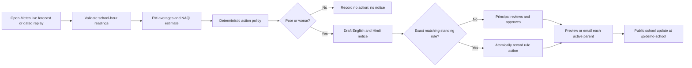

# Saans · School Air-Quality Action Desk

Saans helps a school principal review a modelled school-hours air-quality estimate, apply a deterministic outdoor-activity policy, and decide whether families need an update. Poor days can include a two-hour window with estimated AQI at or below 200. Very Poor and Severe days recommend cancelling outdoor activities. Good through Moderate days need no approval or parent notice.

## Run locally

Requires Node.js 20.19+ (or 22.12+), npm, and Docker (or a local MongoDB service).

```powershell
docker compose up -d mongo
Copy-Item server/.env.example server/.env
npm install
npm --prefix server install
npm --prefix client install
npm run seed
npm run dev
```

Open the Vite URL printed in the terminal (normally `http://localhost:5173`). Demo login: `principal@saans.demo` / `schoolair`. The default data provider is live Open-Meteo, and notice delivery defaults to preview-only. If the live forecast is unavailable, the dashboard reports an error; it does not silently substitute a replay. Select a dated saved replay in the dashboard to try the demo without relying on today's forecast.

For local email testing, put comma-separated test addresses in `DEMO_PARENT_EMAILS` in `server/.env`, then run `npm run seed` again. Approval records a preview by default; it does not send email until SES is explicitly configured.

## Data and replay examples

Live forecasts come from the [Open-Meteo Air Quality API](https://open-meteo.com/en/docs/air-quality-api), requested for the school's coordinates and timezone. The API returns modelled hourly PM2.5 and PM10 estimates. Saans labels fetched data with its timestamp and provenance; it requires at least four valid school-hour readings. This is not a playground sensor measurement.

The repository contains three dated examples saved from the same API for the demo school coordinates: Severe (12 Jul 2026), Poor (17 Aug 2026), and Good (21 Jul 2026). Their source date and fetch timestamp are recorded in each fixture. Refresh or generate examples with:

```sh
npm run fetch-replay -- --from 2026-07-11 --to 2026-10-09
npm run fetch-replay -- --from 2026-07-11 --to 2026-10-09 --save 2026-07-12=severe --save 2026-08-17=limit --save 2026-07-21=clean
```

The command prints each date's school-hour category and available window. Only save dates returned by the API with at least four valid readings. Saved fixtures are for replay and are never used as a silent live-data fallback.

## Product loop



## Parent updates

After the principal approves a non-normal decision, Saans records a delivery result for each active parent. With `NOTIFY_PROVIDER=preview` (the default), this is a local preview record only; no email is sent. Parents can view the latest school update at `http://localhost:5173/p/demo-school` (or the production base URL). The public page only shows a sent restriction, a no-restrictions message, or a stale/not-checked state; it does not expose parent contact information or hourly pollutant readings.

To send real email, set `NOTIFY_PROVIDER=ses`, `SES_SENDER`, `SES_REGION`, and `PUBLIC_BASE_URL`, add parent emails via `DEMO_PARENT_EMAILS`, and seed again. The runtime AWS identity needs permission to send with SESv2. AWS sender/domain identity verification and SES production access are manual deployment prerequisites; AWS resources are not provisioned by this app. SES sandbox accounts can only send to verified recipients. Saans stores per-parent success/failure results and allows retrying failed sends from the principal dashboard. It does not send SMS or WhatsApp messages.

## Optional AWS integrations

| Service | Role | Configuration |
|---|---|---|
| Amazon Bedrock | Optional English/Hindi notice wording; code still selects the action and validates the draft | `LLM_PROVIDER=bedrock`, `AWS_REGION`, `BEDROCK_MODEL_ID`; provide runtime credentials/role |
| Amazon SESv2 | Parent email delivery | `NOTIFY_PROVIDER=ses`, `SES_SENDER`, `SES_REGION` |
| Amazon EventBridge | Trigger the daily school run | POST `/api/cron/daily` with `x-cron-secret`; set `ENABLE_LOCAL_CRON=false` and `SCHEDULER_PROVIDER=EventBridge` |
| MongoDB Atlas | Hosted persistent database | `MONGODB_URI` |
| Container hosting | Host the Docker image and React client | Set `HOSTING_PROVIDER` and `PUBLIC_BASE_URL` |

For local development, `node-cron` calls the daily job at `DAILY_CRON` (default 06:00 Asia/Kolkata). On a hosted deployment, disable local cron when an external scheduler owns the job. The System Status panel shows the configured provider/scheduler and recent run and delivery counts.

## API

All routes except health, login, public update, and secret-protected cron require a JWT bearer token.

- `GET /api/health`
- `POST /api/auth/login`, `GET /api/auth/me`
- `GET /api/decisions/today`, `GET /api/decisions`
- `POST /api/decisions/:id/approve` (a second approval or no-action approval returns 409)
- `POST /api/decisions/:id/resend` (retry failed email deliveries)
- `GET|POST /api/rules`, `DELETE /api/rules/:id`
- `GET /api/parents` (masked addresses for the authenticated school)
- `GET /api/system/status`
- `POST /api/demo/reset` (replay decisions and rules only; controlled by `DEMO_MODE`)
- `POST /api/replay/run` with `{ "mode": "severe" }`, `"limit"`, or `"clean"`
- `GET /api/public/:slug/today` (rate-limited, scrubbed public status)
- `POST /api/cron/daily` with `x-cron-secret`

## Run tests and build

```sh
npm test
npm run build
```

The server uses Node's built-in test runner. Build a production container from the repository root with `docker build -f server/Dockerfile -t saans .`; provide MongoDB and secrets at runtime.

## Safety limits

- Saans produces a planning estimate from modelled hourly pollutant values. Its school-hours average and AQI bands should be reviewed against current official Indian AQI guidance before operational use. It is not a health advisory.
- A Poor standing rule only permits `limit_outdoor`; Very Poor or Severe rules only permit `cancel_outdoor`. Rules cannot override the deterministic action. Matching rules expire and their wording is snapshotted on the decision.
- A notice is generated only for Poor-or-worse decisions. Approval must be recorded before parent email dispatch. The notice validator checks category/action facts and required window times; fixed templates are used when model output fails validation.
- Demo credentials and `DEMO_MODE=true` are for local use. Use strong JWT/cron secrets, HTTPS, a protected MongoDB connection, and a managed AWS runtime identity in hosted environments.

## Disclosure

AI coding tool used: OpenAI Codex. Direct open-source dependencies and their licenses are listed in [THIRD_PARTY_NOTICES.md](./THIRD_PARTY_NOTICES.md). The UI uses DM Sans, Manrope, and Noto Sans Devanagari from Google Fonts when online; system fonts are the fallback.
