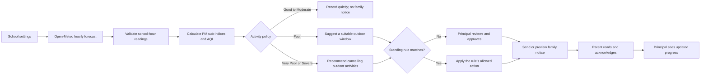

# Saans

### School Air-Quality Action Desk

**A practical morning workflow for school air-quality decisions:** review a local forecast, decide what happens to outdoor activities, and keep families informed.

**Minutes from breach to notice:** Saans measures from the first school-hour AQI above 300 to notice publication (the first successful email, or approval time in preview mode). Replay decisions show elapsed time while approval is pending; days without a breach show no response-time value. This is computed per decision from existing readings and timestamps, not a fixed performance claim.

Saans is a full-stack web app for school principals and parents. It turns modelled hourly PM2.5 and PM10 data into a school-hours AQI estimate, applies a deterministic activity policy, and supports bilingual notices, parent acknowledgements, and a clear decision history.

---

## Status

The repository contains a working local MVP with live forecast lookup, replay scenarios, principal approval, parent accounts and acknowledgements. It also includes opt-in district response metrics, a tomorrow forecast view, and teacher action confirmations. Notices use fixed bilingual templates. Email delivery defaults to preview mode; AWS resources are not provisioned by this project.

## Safety

- Saans is a **process tool**, not medical advice. Its regional model estimate is not a sensor reading or a health recommendation.
- **The school remains open unless the school informs families otherwise.** Saans recommends changes to outdoor activities only.
- Notices use fixed English and Hindi templates that are checked against the AQI, school status, and action.

---

## District, forecast, and teacher mode

- **District leaderboard:** open [`/district`](http://localhost:5173/district). A school appears only after a principal opts in under School settings. Metrics are computed from stored hourly readings and approved decisions; replay scenarios should not be treated as real incidents. The export is available as CSV from the page. Escalations show as unavailable because this build does not record escalation events.
- **Tomorrow forecast:** principals see a next-morning card. The public `/forecast?lat=...&lon=...` view shows the 24 hours of modelled PM-based AQI, morning summary, a seven-day morning outlook, and CSV download. The API response is cached in memory for 30 minutes per coordinate pair. Open-Meteo provides up to seven forecast days; forecasts use CAMS data, not school sensors. [Open-Meteo Air Quality API](https://open-meteo.com/en/docs/air-quality-api).
- **Teacher mode:** a principal creates a seven-day one-time invite under School settings and shares the link out of band. Teachers open the **Teacher sign in** link on the main sign-in page or choose **Teacher tasks** in the dashboard. First-time teachers activate the principal’s invite to set a password; then they sign in at `/teacher` using the school page slug, teacher name, and password. Their task list has a **Mark done** button for each action. Confirmations appear in the principal dashboard and decision history. Principal and teacher endpoints enforce separate JWT roles.

Teacher accounts and action confirmations are stored in MongoDB. Restarting the server does not clear them. The district aggregation is computed from decisions at request time; it is not a Lambda deployment and does not create AWS resources.

---

## What Saans does

| For principals | For parents |
|---|---|
| Set the school’s location and hours in the dashboard | Sign in to a mobile-friendly parent portal |
| Preview the live reading before saving a location | Read today’s approved notice and recent notices |
| Review the recommended outdoor-activity action | Acknowledge each notice with “I’ve read this” |
| Approve notices, or define an expiring standing rule | Choose English or Hindi |
| Invite, deactivate, or import parent accounts | See the time and reason behind an update |
| Track delivery, acknowledgements, and pending families | View a public, read-only school update page |

### The daily flow



For a timed, three-minute presentation, see the [demo voiceover and shot list](docs/DEMO.md).

**Approval is the default.** Parents receive a notice only after principal approval or an exact matching standing rule. A normal day creates a quiet `no_action` record and does not notify families.

---

## Get started locally

### Requirements

- Node.js 20.19+ (or Node.js 22.12+)
- npm
- Docker Desktop for local MongoDB, or another MongoDB instance

### Install and run

From the repository root, in PowerShell:

```powershell
docker compose up -d mongo
Copy-Item server/.env.example server/.env
npm install
npm --prefix server install
npm --prefix client install
npm run seed
npm run dev
```

Open **http://localhost:5173**. The API runs on port 5000 and Vite proxies `/api` requests to it.

**Demo principal:** `principal@saans.demo` / `schoolair`

Delivery defaults to preview mode. No email is sent in that mode. To create demo parent accounts for the video or a local walkthrough, edit `server/.env` before seeding:

```dotenv
DEMO_PARENT_EMAILS=your-real-test-address@example.org
DEMO_PARENT_PASSWORD=choose-a-demo-password
```

Then run `npm run seed` again. Each configured address becomes an active demo parent using the same demo password. Use addresses you control; fake addresses will fail if you later enable SES delivery.

### Try the parent flow

1. Sign in as the principal and open **Parents**.
2. Add a parent, or import a CSV with `name,email,language` columns (`en`, `hi`, or `both`). Imports accept up to 300 rows.
3. In preview mode, copy the one-time invite link and open it in a private browser window. Invite links expire after seven days.
4. Activate the account with a password of at least eight characters, then sign in at **/parent/login**.
5. Approve a proposed notice in the principal dashboard, or run a replay scenario. Open **/parent** to read and acknowledge the sent notice.
6. Return to the principal dashboard. Acknowledgement progress refreshes automatically while responses are pending.

The public read-only notice board is available at **/p/:slug**. For the seeded demo school, use **/p/demo-school**.

---

## School setup

Use **School settings** to choose:

- School name, locality, latitude/longitude, and school hours
- Daily forecast check time (default **06:00 IST**)
- Principal reminder time (default **one hour before school starts**)

Location can be selected from an India-only locality search, browser geolocation, or manual coordinates. The preview button fetches a live reading for the proposed location without saving it. India is the supported region and the timezone is fixed to `Asia/Kolkata`.

Open-Meteo is a regional model. A locality-level location is useful for planning, but the model cannot distinguish nearby streets or replace a sensor at the school.

New principals can use **Create a school account** on the login screen. Registration creates a principal account and a unique school slug, then signs the principal in to the dashboard.

---

## Decision and notification policy

| Forecast category | Saans recommendation | Family notification |
|---|---|---|
| Good, Satisfactory, or Moderate | No outdoor restriction | None |
| Poor | Limit outdoor activities; show the best available two-hour window with estimated AQI at or below 200 | Only after approval or a matching standing rule |
| Very Poor or Severe | Cancel outdoor activities | Only after approval or a matching standing rule |

The action and bilingual notice wording use deterministic code and fixed validated templates.

Parent-facing notices describe what changes at school, say the school remains open as planned unless the school informs families otherwise, and include the AQI estimate and data limitation. They do not give medical advice or tell parents to keep a child home.

### Timing

- The local scheduler checks configured schools every 15 minutes and runs each school after its configured `checkTime`.
- A normal day stays quiet.
- A live Poor-or-worse decision without a matching standing rule is sent to the principal for approval.
- If that decision is still pending at `notifyBy`, only the principal is reminded.
- Approved or rule-matched notices go to active parents immediately.
- A principal can manually remind delivered-but-unacknowledged parents: at most twice per notice and no more than once every 30 minutes.

Midday escalation checks and day-before heads-ups are not implemented.

---

## Data and replay scenarios

### Live data

Live hourly PM2.5 and PM10 forecasts come from the [Open-Meteo Air Quality API](https://open-meteo.com/en/docs/air-quality-api), requested for the school’s coordinates and `Asia/Kolkata` timezone. Locality search uses the [Open-Meteo Geocoding API](https://open-meteo.com/en/docs/geocoding-api). Saans requires at least four valid readings during configured school hours; incomplete data is reported as unavailable rather than silently replaced with a replay.

### Saved Delhi days

Replay scenarios use saved Delhi data regardless of the school’s configured location:

| Scenario | Source date | Result |
|---|---:|---|
| Very Poor | 22 Nov 2025 | AQI 333; PM2.5 sub-index drives the result |
| Poor | 17 Aug 2026 | Outdoor activities limited; suitable time window available |
| Good | 21 Jul 2026 | No outdoor restriction |

Each fixture stores its source date, fetch timestamp, coordinates, timezone, and provider. Replay decisions are for demonstrating the workflow; they are not a live reading for the selected school.

To inspect historical days and save a new example:

```sh
npm run fetch-replay -- --from 2025-11-01 --to 2025-11-30
npm run fetch-replay -- --from 2025-11-01 --to 2025-11-30 --save 2025-11-22=severe
```

Only save a returned date with at least four valid school-hour readings.

---

## Email and optional AWS services

### Preview mode (default)

Preview mode records the intended delivery without sending email. For parent invitations, the principal can copy the one-time invite link from the Parents screen. Approved notices and reminders are visible in the app’s delivery records.

### Amazon SES

To send email, configure `NOTIFY_PROVIDER=ses`, a verified `SES_SENDER`, `SES_REGION`, `PUBLIC_BASE_URL`, and an AWS runtime identity with SESv2 send permission. Saans sends sequentially, waits at least one second between emails, and retries once after a throttling error.

[SES sandbox quotas and recipient restrictions](https://docs.aws.amazon.com/ses/latest/dg/manage-sending-quotas.html) apply: sandbox sends are limited to verified identities, about 200 messages per 24 hours, and one message per second. Sender/domain verification and [SES production access](https://docs.aws.amazon.com/ses/latest/dg/request-production-access.html) are manual setup steps. This project does not create AWS resources. SMS and WhatsApp delivery are not implemented.

### Optional integrations

| Service | Purpose | Key settings |
|---|---|---|
| Amazon SESv2 | Principal alerts, parent invitations, notices, reminders | `NOTIFY_PROVIDER=ses`, `SES_SENDER`, `SES_REGION` |
| EventBridge or another scheduler | Call the daily job endpoint | Disable local cron and protect `POST /api/cron/daily` with `CRON_SECRET` |
| MongoDB Atlas | Hosted persistent database | `MONGODB_URI` |
| Container hosting | Run the bundled Express API and React client | `PUBLIC_BASE_URL`, `HOSTING_PROVIDER` |

---

## Configuration reference

Copy `server/.env.example` to `server/.env`. Do not commit the local `.env` file or production secrets.

| Variable | Default | Purpose |
|---|---|---|
| `PORT` | `5000` | Express server port |
| `MONGODB_URI` | `mongodb://127.0.0.1:27017/saans` | MongoDB connection string |
| `JWT_SECRET` | local demo value | Principal and parent session signing; replace for hosted use |
| `CRON_SECRET` | empty | Secret for scheduled job requests; set for hosted use |
| `SCHOOL_NAME`, `SCHOOL_LAT`, `SCHOOL_LNG` | Saans demo school in Delhi | Seeded demo school details |
| `SCHOOL_START`, `SCHOOL_END` | `08:00`, `14:00` | Seeded demo school hours |
| `SCHOOL_LOCATION_LABEL` | `Delhi, India` | Label shown for the seeded school location |
| `CHECK_TIME`, `NOTIFY_BY` | `06:00`, `07:00` | Seeded check and principal reminder times |
| `FORECAST_PROVIDER` | `live` | `live` or `replay` data provider |
| `ENABLE_LOCAL_CRON` | `true` | Run the local 15-minute scheduler |
| `DEMO_PRINCIPAL`, `DEMO_PASSWORD` | demo login | Seeded principal account |
| `DEMO_PARENT_EMAILS`, `DEMO_PARENT_PASSWORD` | empty list, `familyair` | Optional activated parent demo accounts |
| `NOTIFY_PROVIDER` | `preview` | `preview` or `ses` delivery |
| `SES_SENDER`, `SES_REGION`, `SES_SEND_DELAY_MS` | blank, `us-east-1`, `1100` | SES identity, region, and minimum send interval |
| `PUBLIC_BASE_URL` | `http://localhost:5173` | Base URL for invite and notice links |
| `DEMO_MODE` | `true` outside production | Enables demo reset endpoint |
| `SCHEDULER_PROVIDER`, `HOSTING_PROVIDER` | `local` | Displayed deployment configuration labels |

For production, use long random JWT and cron secrets, HTTPS, a protected database, a managed AWS identity, and a public base URL that points to the deployed app.

---

## API map

All endpoints are under `/api`. Principal and parent endpoints require a bearer token with the matching role. Login, registration, invite validation/activation, public pages, health, geocoding, and the secret-protected cron endpoint are public or separately protected as indicated.

| Area | Endpoints |
|---|---|
| Health | `GET /health` |
| Principal auth | `POST /auth/login`, `POST /auth/register`, `GET /auth/me` |
| School | `GET /school`, `PUT /school`, `POST /school/preview` |
| Geocoding | `GET /geo/search?q=...` (rate limited) |
| Decisions | `GET /decisions/today`, `GET /decisions`, `GET /decisions/:id/summary`, `POST /decisions/:id/approve`, `/resend`, `/remind` |
| Standing rules | `GET /rules`, `POST /rules`, `DELETE /rules/:id` |
| Parents (principal) | `GET /parents`, `POST /parents`, `POST /parents/import`, `POST /parents/:id/resend-invite`, `POST /parents/:id/deactivate` |
| Parent account | `GET /parent/invite/:token`, `POST /parent/activate`, `POST /parent/login`, `GET /parent/me` |
| Parent notices | `GET /parent/notices`, `POST /parent/notices/:decisionId/acknowledge` |
| Public notice board | `GET /public/:slug/today` |
| Public district | `GET /district`, `GET /district/summary?days=30`, `GET /district/csv?days=30` |
| Tomorrow forecast | `GET /forecast?lat=...&lon=...` |
| Teacher mode | `POST /teacher/invite`, `GET /teacher/invite/:token`, `POST /teacher/activate`, `POST /teacher/login`, `GET /teacher/today`, `POST /teacher/confirm`, `GET /teacher/confirmations` (principal) |
| System status | `GET /system/status` |
| Demo tools | `POST /demo/reset`, `POST /replay/run` |
| Scheduler | `POST /cron/daily` with `x-cron-secret` |

Parents can access only their own school’s sent notices and their own acknowledgements. Drafts, standing rules, other families, and hourly pollutant values are not returned by parent endpoints.

---

## Development commands

```sh
npm run dev       # API + Vite development server
npm run build     # production client build
npm test          # server unit tests
npm run seed      # create/update the local demo principal and optional demo parents
```

Build the production container from the repository root:

```sh
docker build -f server/Dockerfile -t saans .
```

The container serves the built client and API on port 5000. Provide MongoDB and environment secrets separately at runtime.

### Project layout

```text
client/                  React + Vite interface
  src/pages/             Principal dashboard, school setup, parent portal
  src/components/        Decision cards, notice preview, rules, history
server/
  src/routes/            Principal, parent, school, public, district, forecast, teacher, and cron APIs
  src/models/            MongoDB schemas, teacher accounts and confirmations
  src/services/           Forecast, AQI, policy, leaderboard, notice templates, delivery pipeline
  src/data/replay/        Saved Open-Meteo replay fixtures
  test/                   Node.js unit tests
```

---

## Scope and limitations

- School location is limited to India; locality selection cannot resolve street-level variation.
- Deterministic code controls both the action and validated bilingual notice wording.
- Principal approval is required unless a matching, unexpired standing rule explicitly permits the deterministic action.
- Parent messages are email/portal only. SMS and WhatsApp are out of scope.
- Midday re-checks and day-before notifications are not implemented.

## Credits and disclosure

Development assistance: OpenAI Codex. Forecast, geocoding, and replay data: [Open-Meteo](https://open-meteo.com/). Fonts: DM Sans, Manrope, and Noto Sans Devanagari via Google Fonts when online, with system fallbacks. Direct open-source dependencies and license details are in [THIRD_PARTY_NOTICES.md](./THIRD_PARTY_NOTICES.md).
